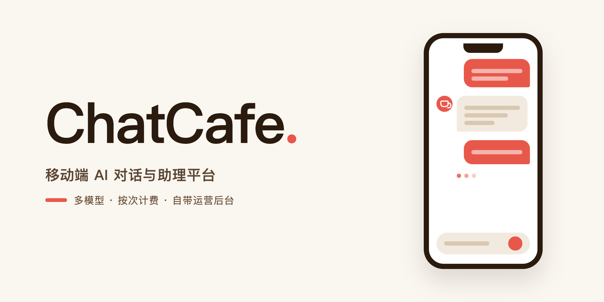
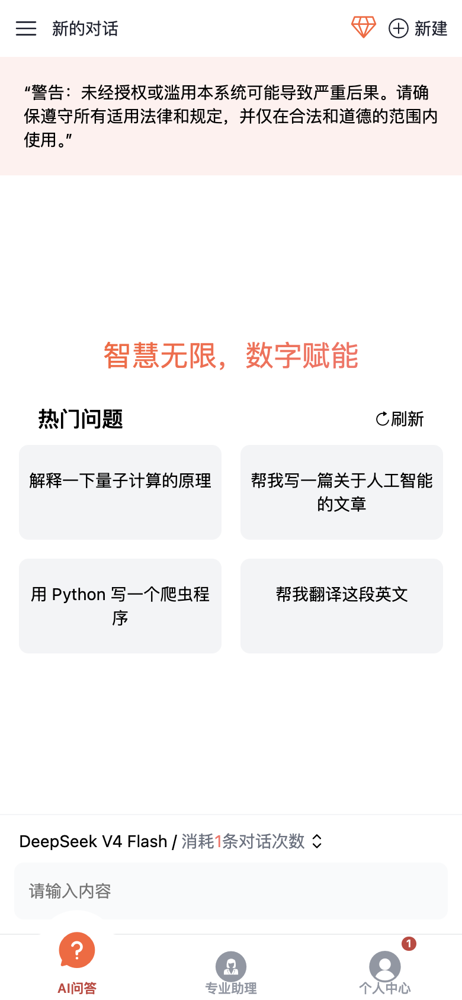
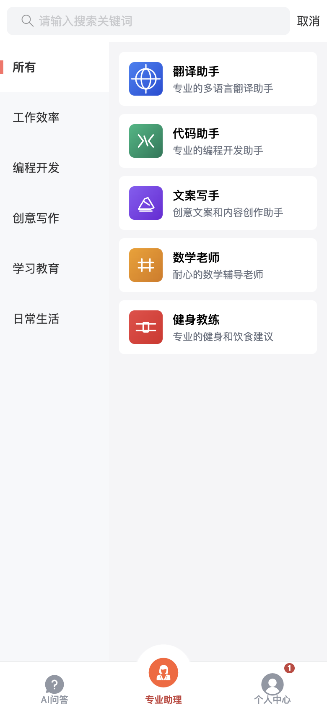
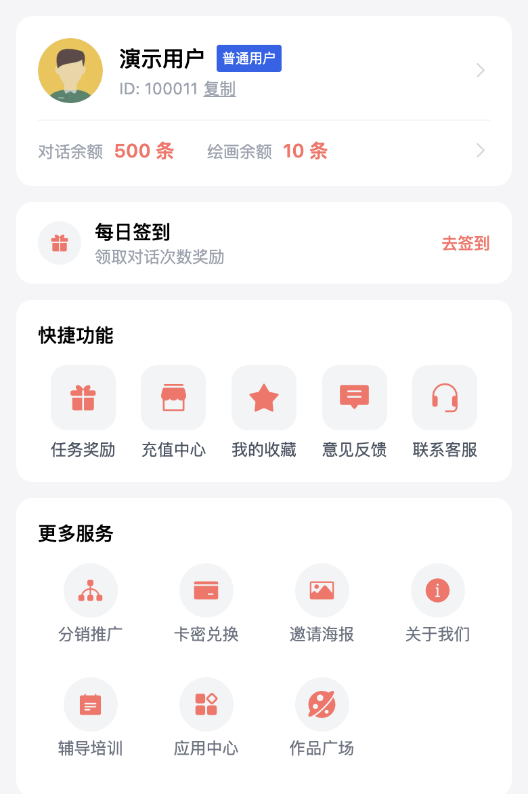
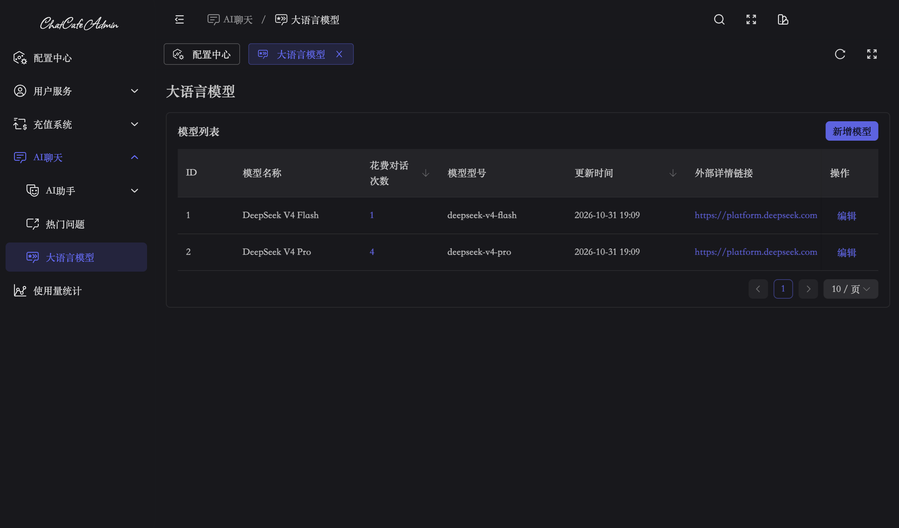

# ChatCafe

<p align="center">
  
</p>

**移动端 AI 对话与助理平台，多模型可配，自带计费、会员与运营体系。**
A mobile AI chat & assistant platform with pluggable models, built-in billing, membership and operations.

[](https://nodejs.org)
[](https://www.postgresql.org)
[](https://vuejs.org)
[](https://docs.docker.com/compose/)

[功能](#功能) • [界面](#界面) • [技术栈](#技术栈) • [快速开始](#快速开始) • [Docker 部署](#docker-部署) • [项目结构](#项目结构)

## 这是什么

ChatCafe 是一套可以直接跑起来的移动端 AI 应用：用户在手机浏览器里注册登录，挑一个预置助手或直接开聊，按对话次数计费；运营者在管理后台配置模型 Key、商品价格和运营活动。

它起源于 2024 年 7 月的一个外包项目：签了合同，自己在家从早写到晚干了两个月，每周汇报进度，全程没用 AI 辅助工具。单子最后不了了之，代码留下了。2026 年回头审视，当时的编码工整、清晰、简单易懂，于是重新接上新的上游模型，让它继续发挥价值：既能作为一套完整的 AI 应用参考实现，也可以作为申请各项资质验证（支付进件、备案等）的真实业务载体。

> [!NOTE]
> 种子数据里的模型 API Key 为空字符串，部署后需要在管理后台填入你自己的 Key 才能真正对话。

## 界面

<p align="center">
  
</p>
<p align="center">
  
</p>

## 功能

**面向用户**（移动端 H5）：

- 多模型 AI 对话，SSE 流式输出，按次数扣费，余额不足自动拦截
- 预置专业助手（翻译、代码、文案、数学、健身等），按分类浏览，支持搜索
- 每日签到、任务奖励、卡密兑换、邀请海报、分销推广等运营功能
- 个人中心：对话/绘画余额、充值中心（蓝兔支付）、收藏与反馈

**面向运营**（管理后台）：

- 语言模型管理：接入任意 OpenAI 兼容接口（baseUrl + model + apiKey），配置每次对话消耗次数
- 用户与订单管理、商品定价、使用量统计
- 助手与热门问题运营、站点配置（站名、备案号、联系邮箱）

> [!WARNING]
> AI 绘画模块的前后端入口还在，但接口当前整体返回「暂未开放」，仅作占位。生产环境请以实际开放状态为准。

## 技术栈

| 层 | 技术 |
| --- | --- |
| 后端 | Node.js >= 18 + Elysia + Prisma |
| 管理后台 | Vue 3 + Naive UI + Vite |
| 移动端 | Vue 3 + Vant + Vite |
| 数据库 | PostgreSQL 16 |
| AI SDK | Vercel AI SDK（`@ai-sdk/openai`，任意 OpenAI 兼容上游） |
| 部署 | Docker Compose + Nginx |

## 快速开始

前置要求：Node.js >= 18、pnpm、Docker（只用来跑 PostgreSQL）。

```bash
# 1. 启动数据库（自动拉取 postgres:16-alpine）
docker compose up -d postgres

# 2. 安装依赖
pnpm install

# 3. 生成 Prisma Client（编译当前平台的查询引擎）
cd api && pnpm exec prisma generate && cd ..

# 4. 建表 + 种子数据
cd api
pnpm exec dotenvx run -f .env.development -- pnpm exec prisma db push
pnpm exec tsx prisma/seed.ts
cd ..

# 5. 一键启动三个服务
pnpm dev
```

等三个服务都起来后，验证 API 已就绪：

```bash
curl http://localhost:9091/config/site
# {"status":0,"data":{"siteName":"ChatCafe",...}}
```

| 服务 | 地址 |
| --- | --- |
| 移动端 | http://localhost:5173 |
| 管理后台 | http://localhost:8000 |
| API 后端 | http://localhost:9091 |

> [!TIP]
> 默认数据库连接读的是 `api/.env.development` 里的 `DATABASE_URL`（localhost:5432）。如果你的 PostgreSQL 端口不是 5432，改这一行即可；`.env*` 文件用 dotenvx 加密，本地修改请配合 `pnpm exec dotenvx set` 使用。

### 配置 AI 模型

登录管理后台 → AI 聊天 → 大语言模型，编辑或新增模型，填入你的上游信息：

| 字段 | 说明 | 示例 |
| --- | --- | --- |
| 模型名称 | 前端下拉框展示并以此匹配 | `DeepSeek V4 Flash` |
| 模型型号 | 传给上游的 model 参数 | `deepseek-chat` |
| baseUrl | OpenAI 兼容接口地址 | `https://api.deepseek.com` |
| apiKey | 上游密钥 | `sk-...` |
| 花费对话次数 | 每次对话扣除的次数 | `1` |

## Docker 部署

### 构建镜像

四个服务都有 Dockerfile（api 的叫 `api/dockerfile`）：

```bash
docker build -t your-registry/chatcafe/api:latest     -f api/dockerfile api/
docker build -t your-registry/chatcafe/admin:latest   admin/
docker build -t your-registry/chatcafe/client:latest  client/
docker build -t your-registry/chatcafe/gateway:latest gateway/

docker push your-registry/chatcafe/api:latest
docker push your-registry/chatcafe/admin:latest
docker push your-registry/chatcafe/client:latest
docker push your-registry/chatcafe/gateway:latest
```

### 部署到服务器

把 `docker-compose.yml` 和 `.env` 放到服务器上（或用 1Panel Compose 管理），`.env` 参考 `.env.example`。首次部署需要准备：

1. `api/.env.production`：dotenvx 加密的运行时配置（短信、支付、管理员账号等），私钥通过根目录 `.env` 的 `DOTENV_PRIVATE_KEY_PRODUCTION` 注入
2. 构建好的四个镜像已推到 `IMAGE_REGISTRY`

```bash
# 拉镜像 + 启动
docker compose pull
docker compose up -d

# 建表 + 种子数据（首次部署）
docker compose run --rm chatcafe-api pnpm exec prisma db push
docker compose run --rm chatcafe-api pnpm exec tsx prisma/seed.ts
```

| 路径 | 服务 |
| --- | --- |
| `/` | 移动端 |
| `/admin/` | 管理后台 |
| `/api/*` | API 后端 |
| `/media/*` | 媒体文件（助手图标、用户头像等） |

### 从本地推送数据库结构到生产库

本地能连到生产库的话，也可以直接推：

```bash
cd api
pnpm exec dotenvx run -f .env.production -- pnpm exec prisma db push
pnpm exec tsx prisma/seed.ts
```

### 关于 Prisma binaryTargets

不同操作系统需要不同的 Prisma 引擎二进制。`api/prisma/schema.prisma` 中已配置：

```prisma
binaryTargets = ["native", "linux-musl-openssl-3.0.x"]
```

- `native`：本地开发机（macOS / Windows 自动适配）
- `linux-musl-openssl-3.0.x`：Docker 部署（Alpine Linux）

如果部署到其他 Linux（如 Ubuntu），添加 `linux-glibc-openssl-3.0.x`；ARM 架构添加 `linux-arm64-*` 系列。

## 项目结构

```
chatcafe/
├── api/                # 后端 API（Elysia + Prisma）
├── admin/              # 管理后台（Vue3 + NaiveUI）
├── client/             # 移动端（Vue3 + Vant）
├── gateway/            # Nginx 反向代理
├── docker-compose.yml  # 部署编排
├── .env.example        # 部署配置模板
└── package.json        # 根目录 pnpm dev 一键启动
```

## 常用命令

```bash
pnpm dev                              # 一键启动所有开发服务
docker compose up -d postgres         # 启动本地数据库
docker compose up -d                  # 启动所有 Docker 容器
docker compose logs -f chatcafe-api   # 查看 API 日志
```
